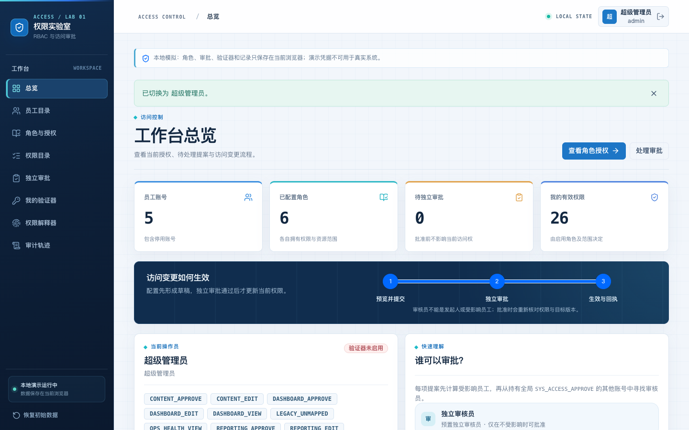
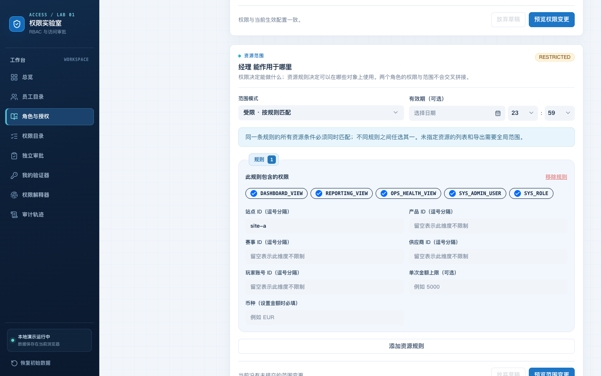
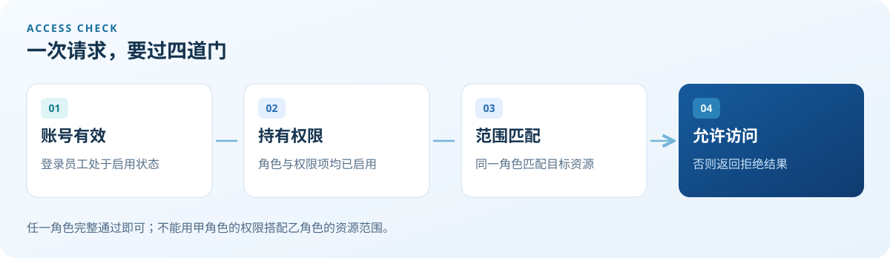
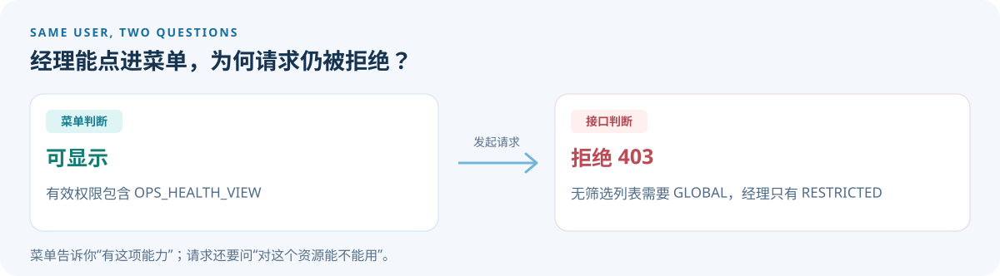

# 从角色到资源：一个能亲手试错的 RBAC 权限实验室

给一个人分配“经理”角色，事情就结束了吗？当然没有。经理可以看报表，但能看**哪个站点**的报表？能查看一条记录，是否也能一键导出所有记录？如果有人要修改权限，谁来确认？权限系统要是只会回答“他是经理”，就像门卫只看工牌、不看门牌。

我做了一个中文前端演示项目「权限实验室」，把这些问题摆到同一个工作台里。它用 Vue 3、TypeScript 和 Vite 构建，页面中可以切换员工账号、编辑角色权限、限制资源范围、提交变更给独立审核员，还能用权限解释器观察一次请求为什么通过或被拒绝。

**在线预览：**[权限实验室](https://wkylin.github.io/rbac-access/) · **源代码：**[GitHub 仓库](https://github.com/wkylin/rbac-access)



*工作台把角色、待审批提案和当前有效权限放在一起。演示账号与密码可以在登录页查看。*

## 权限是动作，资源规则是门牌号

这个项目把权限代码看作“能做什么”，例如 `OPS_HEALTH_VIEW` 表示查看系统健康信息；资源规则回答“能对什么对象做”。预置的「经理」角色持有该权限，但它的范围是 `RESTRICTED`，规则只允许站点 `site-a`。

| 同一位经理发起的请求 | 结果 | 原因 |
| --- | --- | --- |
| 查看 `site-a` 的系统健康信息 | 允许 | 权限代码和站点规则都命中 |
| 查看 `site-b` 的系统健康信息 | 拒绝 | 有查看权限，但站点不在范围内 |
| 不指定站点，获取完整列表或导出 | 拒绝 | 这类请求需要 `GLOBAL` 范围 |



*编辑器可按站点、产品、赛事、供应商、玩家账号和可选金额上限配置规则。规则只能使用该角色已经拥有的权限代码。*

判断逻辑里有一小段值得看。下面摘自 [`src/domain.ts`](../../src/domain.ts)，省去了金额检查：

```ts
if (!rule.permissionCodes.includes(code)) return false;
if (!DIMENSIONS.every(key =>
  !rule.resources[key]?.length ||
  rule.resources[key].includes(query[key].trim())
)) return false;
```

读作人话就是：这条规则必须包含当前权限；规则中**填了值的每个资源维度**都要匹配。某个维度留空，表示这条规则不限制该维度；同一维度填多个 ID，命中任意一个即可。受限规则至少要指定一种资源 ID；如果设了 `5000 EUR` 的金额上限，请求还得同时满足金额不超过 5000、币种为 EUR（欧元）。角色可以有多条规则，完整命中其中一条就行。更关键的是，权限与资源必须在**同一角色、同一规则**里配对，不能从甲角色拿权限、从乙角色借站点，现场拼一张“万能通行证”。



## 菜单能看见，接口却说 403？

这不一定是程序闹脾气。菜单通常只掌握用户的有效权限代码，不知道这次请求的具体站点；真正的请求还带着站点、产品或账号等资源信息。权限解释器把两层判断并排展示：左边是权限代码能否让菜单出现，右边是当前请求能否通过资源检查。

用预置 `manager` 和 `OPS_HEALTH_VIEW` 试一下：关闭“无筛选列表或导出”，填写 `site-a`，请求可通过；改成 `site-b`，结果会被拒绝；再开启无筛选列表，即使保留 `site-a`，也必须使用全局范围。这比盯着一个 403 猜半天有效率，也适合给产品同学解释“按钮可见”和“数据可访问”为什么不是同一个问题。



## 改权限，得有人说“我看过了”

直接点“保存”就生效很方便，也很适合制造事故。这里采用发起人与审核员分离的流程：管理员先预览权限或范围变更，填写理由并提交提案；独立审核员核对前后状态、受影响员工，再批准或拒绝。批准前，当前权限保持原样；拒绝也不会改动权限。

预览时，项目会把操作类型、目标、变更前后状态、受影响员工和目标版本计算成 SHA-256 **影响指纹**。审核时再计算一次；如果其间状态已经变化，旧提案就不能直接套用。这是演示中的“别拿昨天的菜单点今天的菜”，不是用哈希值替代服务端事务或数字签名。代码位于 [`src/store.ts`](../../src/store.ts)。

代码按职责拆开：[`src/domain.ts`](../../src/domain.ts) 集中处理权限与资源判定，[`src/store.ts`](../../src/store.ts) 管理提案、审批和本地持久化，Vue 页面负责让这些规则能被操作和观察。项目还包含员工、角色和权限项的停用与重新启用、审计记录，以及登录验证器演示。它用 Web Crypto 校验 30 秒周期的 6 位 TOTP；这能帮助理解动态验证码怎样接入登录流程，但这里的密钥和状态都保存在浏览器里。

## 亲手走一遍

1. 打开[在线预览](https://wkylin.github.io/rbac-access/)，用 `admin` 和登录页给出的演示密码进入工作台。
2. 在“角色与授权”选择 `OPERATOR`，调整一项权限并预览，填写理由后提交提案。此时变更尚未生效。
3. 切换到 `reviewer`，在“独立审批”核对并批准；回到角色页看结果，再到“审计轨迹”看记录。
4. 到“权限解释器”选择 `manager`、`OPS_HEALTH_VIEW`，依次试 `site-a`、`site-b` 和无筛选列表，观察同一权限在不同资源下的结果。

最后记住这条边界：这是**纯前端、数据保存在本机浏览器**的教学项目。它把判定和审批过程摊开给你看，但浏览器里的密码复核、TOTP 和审批不能充当生产安全控制。真正的系统必须在服务端验证身份与权限、保护密钥，并以原子操作应用审批结果。
